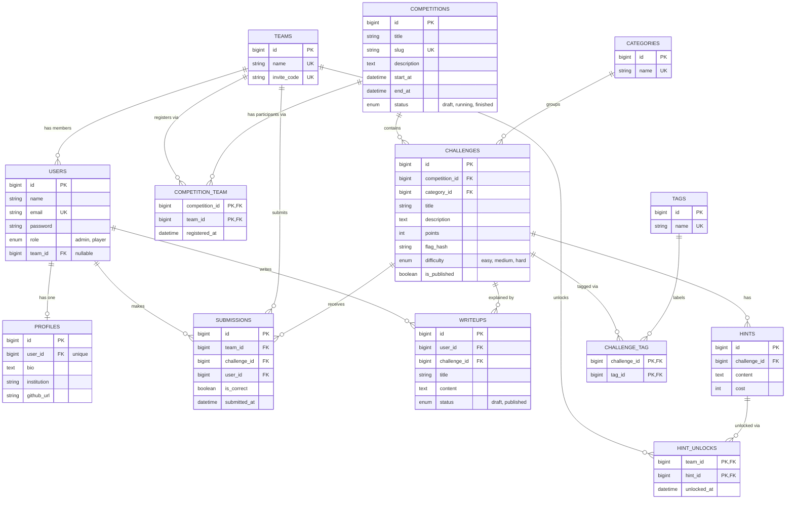

# Database Design — Entity Relationship Diagram

This document describes the database schema of **Flagboard** and every Eloquent relationship used in the project.

## 1. Entity Relationship Diagram

## 2. Relationship Summary

| Type | Relationship | Eloquent |
|---|---|---|
| One-to-One | `User` ↔ `Profile` | `hasOne` / `belongsTo` |
| One-to-Many | `Team` → `User` | `hasMany` / `belongsTo` |
| One-to-Many | `Competition` → `Challenge` | `hasMany` / `belongsTo` |
| One-to-Many | `Category` → `Challenge` | `hasMany` / `belongsTo` |
| One-to-Many | `Challenge` → `Hint` | `hasMany` / `belongsTo` |
| One-to-Many | `Challenge` → `Writeup` | `hasMany` / `belongsTo` |
| One-to-Many | `User` → `Writeup` | `hasMany` / `belongsTo` |
| One-to-Many | `User` → `Submission` | `hasMany` / `belongsTo` |
| One-to-Many | `Team` → `Submission` | `hasMany` / `belongsTo` |
| One-to-Many | `Challenge` → `Submission` | `hasMany` / `belongsTo` |
| Many-to-Many | `Challenge` ↔ `Tag` (pivot `challenge_tag`) | `belongsToMany` |
| Many-to-Many + pivot data | `Team` ↔ `Competition` (pivot `competition_team`, column `registered_at`) | `belongsToMany` + `withPivot` |
| Many-to-Many + pivot data | `Team` ↔ `Hint` (pivot `hint_unlocks`, column `unlocked_at`) | `belongsToMany` + `withPivot` |
| Many-to-Many + pivot data | `Team` ↔ `Challenge` (table `submissions`, columns `is_correct`, `submitted_at`) | `belongsToMany` + `withPivot` |
| Has-Many-Through | `Competition` → `Submission` through `Challenge` | `hasManyThrough` |
| Has-Many-Through | `Category` → `Submission` through `Challenge` | `hasManyThrough` |

`submissions` is both a table with its own `id` and the link between `Team` and `Challenge`. It is modelled as an Eloquent model (`Submission`) for the one-to-many relationships, and the `Team` ↔ `Challenge` many-to-many relationship points to the same table.

## 3. Categories (seeded)

The `categories` table is populated by a seeder with the six built-in categories:

| Name |
|---|
| Web |
| Cryptography |
| Forensics |
| Reverse Engineering |
| Pwn |
| Miscellaneous |

## 4. Design Notes

- **Unique constraints:** `users.email`, `profiles.user_id`, `teams.name`, `teams.invite_code`, `competitions.slug`, `categories.name`, and `tags.name`.
- **Composite primary keys:** the pivot tables `competition_team`, `challenge_tag`, and `hint_unlocks` use their two foreign keys as the primary key, so a team cannot register twice for a competition or unlock the same hint twice.
- **Flags** are stored only as a hash in `challenges.flag_hash` (created with `Hash::make`, verified with `Hash::check`). `submissions` stores only `is_correct`, not the submitted text.
- **One correct submission per team per challenge** is enforced in application logic (validation before insert), because a partial unique index is not portable across MySQL and SQLite.
- **Team membership:** `users.team_id` is nullable, so a player can exist without a team. A user belongs to at most one team.
- **Score** is computed, not stored: sum of `challenges.points` for correct submissions, minus sum of `hints.cost` for rows in `hint_unlocks`.
- **Cascade rules (planned):** deleting a competition cascades to its challenges and registrations; deleting a challenge cascades to its hints, tags, unlocks, submissions, and writeups; deleting a team sets `users.team_id` to null and cascades to its registrations, unlocks, and submissions. Deleting a category is restricted while challenges still use it.